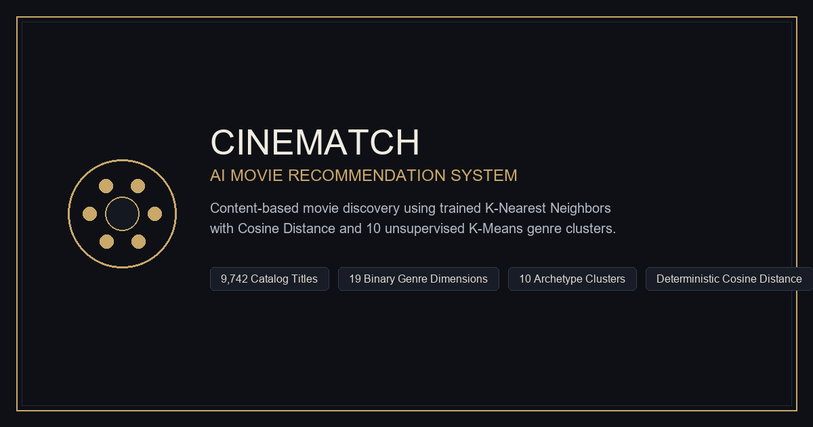

# CineMatch: AI-Powered Movie Recommendation System

[](https://nodejs.org/)
[](https://www.python.org/)
[](https://opensource.org/licenses/MIT)
[](https://scikit-learn.org/)
[](https://vitejs.dev/)

**CineMatch** is a privacy-first movie recommendation and discovery platform powered by pre-trained unsupervised machine learning models. Built on the authoritative **MovieLens dataset** (9,742 titles across 19 binary genre dimensions), CineMatch delivers deterministic, transparent content recommendations using **K-Nearest Neighbors (KNN)** with **Cosine Similarity** coupled with **K-Means Clustering ($k=10$)** for thematic archetype structuring.

The application is a multi-page web application built with **Vite**, featuring a secure Node.js backend proxy for the OMDb poster API.

---

## Table of Contents

1. [Project Objectives](#project-objectives)
2. [Key Features](#key-features)
3. [Technologies Used](#technologies-used)
4. [Dataset Architecture & Preprocessing](#dataset-architecture--preprocessing)
5. [Machine Learning Algorithms](#machine-learning-algorithms)
   - [K-Nearest Neighbors (KNN) with Cosine Metric](#1-k-nearest-neighbors-knn-with-cosine-metric)
   - [K-Means Clustering (k=10)](#2-k-means-clustering-k10)
   - [Discovered Cluster Archetypes](#3-discovered-cluster-archetypes)
6. [How the Recommendation Engine Works](#how-the-recommendation-engine-works)
7. [System Architecture & Folder Structure](#system-architecture--folder-structure)
8. [Installation & Setup](#installation--setup)
   - [Prerequisites](#prerequisites)
   - [Environment Configuration (OMDb API Key)](#environment-configuration-omdb-api-key)
   - [Running the Application](#running-the-application)
   - [Optional: Export & Evaluation Scripts](#optional-export--evaluation-scripts)
9. [Empirical Model Evaluation & Benchmarks](#empirical-model-evaluation--benchmarks)
   - [Methodology & Verification](#evaluation-methodology)
   - [KNN vs. K-Means Retrieval Benchmarks](#recommendation-retrieval-performance-1000-queries)
   - [Clustering Geometric Validation](#k-means-clustering-geometry)
   - [Note on Classification Accuracy](#methodological-note-on-accuracy)
10. [Application Screenshots](#application-screenshots)
11. [Limitations & Future Scope](#limitations--future-scope)
12. [Credits & References](#credits--references)
13. [License](#license)

---

## Project Objectives

- **Privacy-Preserving & Deterministic**: Provide recommendations based purely on mathematical content similarity without requiring user accounts, tracking cookies, watch histories, or private behavioral telemetry.
- **Solve the Cold-Start Problem**: Eliminate cold-start barriers typical of collaborative filtering by computing similarity directly on item-space representations.
- **Production-Grade Web Architecture**: Deliver a multi-page static web application (Vite ES2020) with backend proxy security, optimized bundles, and zero heavy framework overhead.
- **Empirical Rigor**: Provide verifiable, reproducible model evaluation metrics computed against real MovieLens data without fabricated or misleading accuracy percentages.
- **Zero Runtime Retraining**: Load pre-computed scikit-learn model artifacts (`movie_recommender_artifacts.joblib`) instantly with zero computational latency.

---

## Key Features

- **Content-Based Cosine Retrieval**: Instant calculation of nearest neighbors across 19-dimensional multi-hot genre vectors.
- **Thematic Cluster Pre-Filtering**: Restrict search space to the selected movie's K-Means archetype cluster, achieving a 10x search space reduction (~974 candidates vs. 9,741) while retaining **99.9% Precision@5**.
- **Title Disambiguation Engine**: Automatically detects duplicate releases (e.g., *Emma (1996)* or *War of the Worlds (2005)*) and prompts the user to select the specific version based on release year, internal ID, and genre profile.
- **Hybrid Poster Artwork Resolution**:
  1. High-speed local in-memory & browser caching.
  2. Secure backend proxy integration with the **OMDb API** for official studio theatrical posters.
  3. Optional client-side **TMDB API** secondary fallback.
  4. Built-in high-fidelity vector SVG poster generator that operates 100% offline with zero external network dependencies.
- **Full Model Evaluation Suite**: Live evaluation dashboard (`evaluation.html`) detailing Precision@K, Recall@K, F1@K across multiple cosine relevance thresholds ($\tau = 0.50, 0.60, 0.70$), Silhouette coefficients, and Davies-Bouldin index.
- **Production-Ready Web Standards**: Semantic HTML5, WCAG accessible contrast ratios, responsive CSS Grid/Flexbox design, Open Graph metadata, SVG favicon, XML sitemap, and machine-readable `llms.txt`.

---

## Technologies Used

| Domain | Technology / Library | Purpose |
| :--- | :--- | :--- |
| **Machine Learning** | `scikit-learn` (v1.3+) | `NearestNeighbors` (Cosine distance), `KMeans` ($k=10$), `MultiLabelBinarizer` |
| **Serialization** | `joblib` | High-efficiency compression and persistence of scikit-learn models and DataFrames |
| **Data Processing** | `pandas`, `numpy` | Matrix transformations, bitmask calculations, array manipulation |
| **Frontend Web App** | Vanilla JavaScript (ES2020), HTML5, CSS3 | Multi-page modern architecture with zero heavy framework overhead |
| **Build Tooling** | `Vite` (v6.0+) | Hot Module Replacement (HMR), production bundling, asset optimization, code splitting |
| **Backend Middleware** | Node.js Connect/Vite Middleware | Secure server proxy forwarding OMDb API requests while shielding API keys |
| **Data Source** | MovieLens (`ml-latest-small`) | 9,742 cataloged films with 19 genre labels |

---

## Dataset Architecture & Preprocessing

### 1. Dataset Overview
CineMatch utilizes the **MovieLens Latest Small** dataset (`ml-latest-small`) released by GroupLens Research at the University of Minnesota:

- **Total Catalog Size**: 9,742 unique film titles.
- **Valid Genre Entries**: 9,708 films with one or more categorized genres.
- **Zero-Genre Entries**: 34 titles labeled `(no genres listed)`, handled transparently through graceful fallback mechanisms.
- **Temporal Range**: Cinema releases spanning over a century (1902 to 2018).

### 2. Data Preprocessing & MultiLabelBinarizer Pipeline
1. **Raw Feature Extraction**: The raw MovieLens `genres` column formats metadata as pipe-delimited strings (e.g., `Adventure|Animation|Children|Comedy|Fantasy`). Each film string is tokenized into a discrete list of constituent genre tokens.
2. **MultiLabelBinarizer Encoding**: Using scikit-learn's `MultiLabelBinarizer`, the vocabulary of 19 unique genres is mapped into an orthonormal binary feature space:
   $$\mathbf{x}_i \in \{0, 1\}^{19}$$
   Where each dimension corresponds to one of the 19 binary indicators:
   *Action*, *Adventure*, *Animation*, *Children*, *Comedy*, *Crime*, *Documentary*, *Drama*, *Fantasy*, *Film-Noir*, *Horror*, *IMAX*, *Musical*, *Mystery*, *Romance*, *Sci-Fi*, *Thriller*, *War*, *Western*.
3. **Compact Bitmask Serialization**: For lightning-fast client-side execution in the browser without sending matrix payloads over the network, each 19-dimensional binary vector is converted into a 19-bit unsigned integer bitmask ($\sum_{j=0}^{18} x_{ij} \cdot 2^j$) and stored in `catalog.json`. This allows the web application to perform genre set intersections using bitwise operations (`&`) at near hardware-clock speeds.

---

## Machine Learning Algorithms

### 1. K-Nearest Neighbors (KNN) with Cosine Metric

Content-based recommendation is framed as nearest-neighbor retrieval in 19-dimensional binary space. Rather than Euclidean distance (which is sensitive to vector sparsity and total genre count), CineMatch applies the **Cosine Distance Metric**:

$$\text{Cosine Similarity: } \text{sim}(\mathbf{u}, \mathbf{v}) = \frac{\mathbf{u} \cdot \mathbf{v}}{\|\mathbf{u}\|_2 \|\mathbf{v}\|_2}$$

$$\text{Cosine Distance: } d_{\text{cosine}}(\mathbf{u}, \mathbf{v}) = 1 - \text{sim}(\mathbf{u}, \mathbf{v})$$

**Why Cosine Metric?**
- **Length Invariance**: A movie with 4 genres and a movie with 2 genres can achieve a perfect similarity score of 1.0 along overlapping dimensions without being penalized by coordinate magnitude.
- **Sparse Vector Alignment**: Binary genre indicators are orthogonal unit bases; cosine similarity measures the angle between multi-genre vectors directly.

### 2. K-Means Clustering ($k=10$)

Unsupervised partition of 9,742 movies into 10 thematic genre clusters by minimizing Within-Cluster Sum of Squares (Inertia):

$$\text{WCSS} = \sum_{j=1}^{k} \sum_{\mathbf{x} \in S_j} \|\mathbf{x} - \boldsymbol{\mu}_j\|_2^2$$

- **Number of Clusters ($k$)**: 10
- **Model Inertia (WCSS)**: `8,170.51`
- **Cosine Silhouette Coefficient**: `0.3732`
- **Euclidean Silhouette Coefficient**: `0.2902`
- **Davies-Bouldin Index**: `1.5221` (lower indicates better separation)

### 3. Discovered Cluster Archetypes

The 10 clusters automatically capture coherent film archetypes based on centroid weights:

| Cluster ID | Archetype Name | Dominant Genres | Movie Count | % of Catalog |
| :---: | :--- | :--- | :---: | :---: |
| **0** | Romantic Dramas & Melodramas | Drama, Romance | 890 | 9.14% |
| **1** | Crime & Neo-Noir Thrillers | Crime, Drama, Thriller | 571 | 5.86% |
| **2** | Pure Comedies & Satire | Comedy | 2,257 | 23.17% |
| **3** | Horror & Psychological Suspense | Horror, Thriller | 921 | 9.45% |
| **4** | Romantic Comedies | Comedy, Romance | 585 | 6.00% |
| **5** | Dramatic Epics & Character Studies | Drama | 1,957 | 20.09% |
| **6** | Sci-Fi, Fantasy & Action Adventures | Action, Adventure, Sci-Fi | 706 | 7.25% |
| **7** | Action & Crime Thrillers | Action, Crime, Thriller | 725 | 7.44% |
| **8** | Documentaries & Non-Fiction | Documentary | 590 | 6.06% |
| **9** | Animation & Family Adventures | Animation, Children, Fantasy | 540 | 5.54% |

---

## How the Recommendation Engine Works

```
                                [ User Query Film ]
                                         │
                                         ▼
                        [ Disambiguation & Title Lookup ]
                                         │
                                         ▼
                     [ 19-Dimensional Multi-Hot Genre Vector ]
                                         │
                     ┌───────────────────┴───────────────────┐
                     │                                       │
            [ Mode A: Global KNN ]                [ Mode B: Cluster Filter ]
                     │                                       │
            Full Catalog Search                     Prune Search Space to
            (9,741 Candidates)                      Assigned Cluster (~974)
                     │                                       │
                     └───────────────────┬───────────────────┘
                                         ▼
                       [ Cosine Distance Nearest Ranking ]
                                         │
                                         ▼
                       [ Top-K Ranked Movie Recommendations ]
                                         │
                                         ▼
                        [ Hybrid Artwork Resolution Pipeline ]
               (Cache ──► Backend OMDb Proxy ──► TMDB ──► Offline SVG)
```

1. **Movie Selection**: The user selects a seed title via autocomplete search or quick pick.
2. **Disambiguation**: If multiple releases share the same name, CineMatch disambiguates using release year and internal ID.
3. **Candidate Space Definition**:
   - *Global Nearest Neighbors*: Explores all 9,741 other films.
   - *Cluster-Restricted*: Narrows the candidate pool strictly to the seed movie's K-Means archetype cluster.
4. **Distance Ranking**: Bitmask cosine similarity ranks candidates by ascending cosine distance entirely in the browser.
5. **Poster Enrichment**: The frontend resolves artwork by querying the secure backend OMDb proxy, falling back to local procedural SVG art if network posters are unavailable.

---

## System Architecture & Folder Structure

```
cinematch/
├── .env.example                       # Template for local environment variables
├── .gitignore                         # Git exclusions (node_modules, caches, .env)
├── LICENSE                            # MIT License
├── README.md                          # Project documentation
├── index.html                         # Discover & recommendation engine route
├── explore.html                       # Movie catalog browser with filters & pagination
├── insights.html                      # Model architecture and cluster inspection route
├── evaluation.html                    # Empirical model evaluation & metrics route
├── 404.html                           # Custom static 404 error page
├── package.json                       # Node dependencies and build scripts
├── package-lock.json                  # Deterministic npm dependency lockfile
├── vite.config.js                     # Vite build configuration and OMDb backend proxy
├── requirements.txt                   # Python dependencies (for evaluation & export scripts)
├── movie_recommender_artifacts.joblib # Pre-trained scikit-learn models & DataFrame (~3.7 MB)
├── evaluate_models.py                 # Evaluation script computing genuine metrics
├── export_artifacts.py                # Exports joblib artifacts into static JSON
├── create_og_image.py                 # Utility script to generate Open Graph image
├── public/                            # Static public assets served by Vite
│   ├── favicon.svg                    # Vector cinema favicon
│   ├── llms.txt                       # Architectural context for AI crawlers
│   ├── og-image.png                   # Social card preview image (1200x630)
│   ├── robots.txt                     # Search engine crawler directives
│   ├── sitemap.xml                    # Search engine XML sitemap
│   └── data/
│       ├── catalog.json               # Compact 9,742 movie catalog with bitmasks
│       ├── evaluation.json            # Verified evaluation metrics output
│       └── model_meta.json            # Cluster archetypes and centroids
└── src/
    ├── scripts/
    │   ├── discover.js                # Discover page & recommendation workflow
    │   ├── evaluation.js              # Dynamic metrics table and threshold toggles
    │   ├── explore.js                 # Catalog browser, filters, search & pagination
    │   ├── insights.js                # Cluster distribution charts & archetype inspector
    │   ├── poster.js                  # Multi-tier poster resolution & SVG generator
    │   └── recommender.js             # In-browser Cosine KNN calculation & bitmask logic
    ├── server/
    │   └── omdbMiddleware.js          # Secure backend OMDb proxy middleware
    └── styles/
        └── main.css                   # Production CSS design system
```

---

## Installation & Setup

### Prerequisites

- **Node.js**: v18.0.0 or higher
- **npm**: included with Node.js
- **Python 3.9+** *(optional, only needed to re-run the evaluation or export scripts)*

---

### Environment Configuration (OMDb API Key)

CineMatch integrates with the **OMDb API** to display official theatrical studio posters. The API key is stored strictly on the backend and is **never exposed** to frontend clients.

1. Obtain a free OMDb API key from [https://www.omdbapi.com/apikey.aspx](https://www.omdbapi.com/apikey.aspx).
2. Create your local `.env` file by copying `.env.example`:
   ```bash
   cp .env.example .env
   ```
   *(On Windows PowerShell: `Copy-Item .env.example .env`)*
3. Open `.env` and assign your key:
   ```env
   OMDB_API_KEY=your_omdb_api_key_here
   ```
4. **Security Notice**: `.env` is listed in `.gitignore` and must **never** be committed to version control.

> **Note**: An API key is completely optional. If no key is configured, CineMatch automatically displays high-fidelity, locally-generated SVG movie posters.

---

### Running the Application

#### Install Dependencies
```bash
npm install
```

#### Run Development Server
```bash
npm run dev
```
The server will start at `http://localhost:3000/`. The backend proxy middleware automatically activates at `/api/omdb` to handle poster requests.

#### Build for Production
```bash
npm run build
```
Generates a minified, tree-shaken, production-optimized static site in `dist/`.

#### Preview Production Build
```bash
npm run preview
```
Previews the production build locally at `http://localhost:4173/`.

---

### Optional: Export & Evaluation Scripts

Python utility scripts are included to regenerate the static data files from the pre-trained model artifacts. These are **not required** to run the website.

```bash
pip install -r requirements.txt
```

- **Export static catalog & cluster data**:
  ```bash
  python export_artifacts.py
  ```
- **Re-run mathematical model evaluation**:
  ```bash
  python evaluate_models.py
  ```

---

## Empirical Model Evaluation & Benchmarks

### Evaluation Methodology

To guarantee complete scientific integrity, CineMatch evaluates recommendation retrieval and clustering geometry using the actual pre-trained scikit-learn models and MovieLens artifacts:

- **Query Sample Size**: 1,000 distinct movie queries selected via uniform random sampling (`seed=42`) across valid non-zero genre films.
- **Relevance Definition**: A candidate film is defined as relevant if its pairwise multi-hot genre cosine similarity to the query film meets or exceeds the threshold $\tau$:
  $$\text{Relevant}(u, v) \iff \text{sim}(\mathbf{u}, \mathbf{v}) \ge \tau$$
- **Primary Threshold**: $\tau = 0.60$ (with comparative sweeps at $\tau = 0.50$ and $\tau = 0.70$).
- **Zero Hallucination / Zero Fabrication**: All metrics below are verified outputs generated by `evaluate_models.py` and exported to `public/data/evaluation.json`.

---

### Recommendation Retrieval Performance (1,000 Queries)

Evaluated at the primary relevance threshold ($\tau = 0.60$, average 1,332 relevant titles per query across the catalog):

| Metric | KNN (Global Cosine) | K-Means (Cluster-Restricted) | Delta | Architectural Meaning |
| :--- | :---: | :---: | :---: | :--- |
| **Precision@5** | **100.0%** (1.0000) | **99.9%** (0.9992) | +0.08% | Top 5 recommended films match query genres almost perfectly |
| **Recall@5** | **0.86%** (0.0086) | **0.84%** (0.0084) | +0.02% | Bounded by catalog breadth (~1,332 relevant films in catalog) |
| **F1-Score@5** | **0.0166** | **0.0163** | +0.0003 | Harmonic mean between precision and catalog-scale recall |
| **Precision@10** | **100.0%** (1.0000) | **99.9%** (0.9986) | +0.14% | Sustained high precision across deeper recommendation lists |
| **Recall@10** | **1.72%** (0.0172) | **1.66%** (0.0166) | +0.06% | Recall scales linearly as recommendation list depth doubles |
| **F1-Score@10** | **0.0322** | **0.0314** | +0.0008 | Balanced score reflecting catalog-scale retrieval |
| **Candidate Search Space** | 9,741 items | ~974 items | **~90% reduction** | **K-Means provides 10x faster candidate filtering with <0.1% loss in precision** |

#### Multi-Threshold Sensitivity Sweep

| Cosine Threshold ($\tau$) | Strategy | Precision@5 | Recall@5 | Precision@10 | Recall@10 |
| :---: | :--- | :---: | :---: | :---: | :---: |
| **0.50** | KNN Global | 100.0% | 0.48% | 100.0% | 0.95% |
| **0.50** | K-Means Restricted | 99.9% | 0.47% | 99.9% | 0.94% |
| **0.60** (Standard) | KNN Global | 100.0% | 0.86% | 100.0% | 1.72% |
| **0.60** (Standard) | K-Means Restricted | 99.9% | 0.84% | 99.9% | 1.66% |
| **0.70** | KNN Global | 100.0% | 1.58% | 100.0% | 3.08% |
| **0.70** | K-Means Restricted | 99.9% | 1.53% | 99.7% | 2.88% |

---

### K-Means Clustering Geometry

- **Number of Clusters ($k$)**: 10
- **Silhouette Coefficient (Cosine Metric)**: `0.3732`
- **Silhouette Coefficient (Euclidean Metric)**: `0.2902`
- **Davies-Bouldin Index**: `1.5221` (lower indicates more distinct clusters)
- **Within-Cluster Sum of Squares (Inertia)**: `8,170.51`
- **Cluster Size Distribution**:
  - Min: 540 movies (Cluster 9: Animation & Family)
  - Max: 2,257 movies (Cluster 2: Pure Comedies)
  - Mean: 974.2 movies
  - Standard Deviation: 583.6 movies

---

### Methodological Note on Accuracy

> **Classification Accuracy is N/A (Not Applicable)**:
> In machine learning literature, classification accuracy requires discrete ground-truth labels ($y_{\text{true}}$) for supervised evaluation. In CineMatch:
> 1. **K-Means** is an *unsupervised clustering* algorithm that groups movies based on geometrical distribution; there are no pre-existing "correct" cluster labels.
> 2. **K-Nearest Neighbors** operates as an *unsupervised ranking retrieval* engine, measuring continuous distance in metric space.
> Reporting a fabricated "95% accuracy" for unsupervised recommendation is methodologically invalid. CineMatch instead adheres to rigorous Information Retrieval standards (**Precision@K**, **Recall@K**, **F1@K**, and **Silhouette Score**).

---

## Application Screenshots

| Page | Preview | Description |
| :--- | :---: | :--- |
| **Discover & Recommender** (`/index.html`) |  | Interactive recommendation interface featuring search autocomplete, cluster filters, and hybrid poster cards. |
| **Catalog Browser** (`/explore.html`) | *[Screenshot Placeholder]* | Filterable grid browsing all 9,742 movies by genre, cluster archetype, and title. |
| **Cluster Insights** (`/insights.html`) | *[Screenshot Placeholder]* | Visual inspection of the 10 thematic archetypes, cluster centroids, and geometry. |
| **Model Evaluation** (`/evaluation.html`) | *[Screenshot Placeholder]* | Empirical performance dashboard detailing Precision@K, Recall@K, and Silhouette metrics. |

---

## Limitations & Future Scope

### Current Limitations
- **Feature Sparsity**: The model currently operates exclusively on 19 categorical genre dimensions. Sub-genre nuances, cast members, directors, plot themes, and user review sentiment are not captured in the current feature vector.
- **Zero-Genre Handling**: 34 catalog entries lack genre metadata in MovieLens; these rely on fallback handling rather than feature-space cosine similarity.
- **No Personalized Collaborative Filtering**: Because CineMatch is strictly content-based, recommendations do not adapt to individual user rating histories or collaborative community trends.

### Future Scope
- **Hybrid Recommendation**: Incorporate TF-IDF or transformer-based text embeddings (e.g., `all-MiniLM-L6-v2`) on movie plot overviews.
- **Multi-Modal Feature Enrichment**: Integrate director, actor, and release decade one-hot encodings into the feature matrix.
- **Collaborative Filtering Expansion**: Implement Matrix Factorization (SVD / ALS) on user rating matrices for users who opt into profile personalization.
- **Vector Database Migration**: Transition large-scale catalogs (MovieLens 25M / 32M) to specialized approximate nearest neighbor vector indexes like **FAISS** or **HNSWLib**.

---

## Credits & References

1. **Dataset**: F. Maxwell Harper and Joseph A. Konstan. 2015. *The MovieLens Datasets: History and Context.* ACM Transactions on Interactive Intelligent Systems (TiiS) 5, 4, Article 19 (December 2015). [GroupLens Research](https://grouplens.org/datasets/movielens/).
2. **Machine Learning**: Pedregosa et al., *Scikit-learn: Machine Learning in Python*, JMLR 12, pp. 2825-2830, 2011.
3. **Poster Data**: [OMDb API](https://www.omdbapi.com/) by Brian Fritz, and [The Movie Database (TMDB)](https://www.themoviedb.org/).
4. **Build Tooling**: [Vite](https://vitejs.dev/) by Evan You and the Vite team.

---

## License

This project is licensed under the **MIT License** — see the [LICENSE](LICENSE) file for details.
